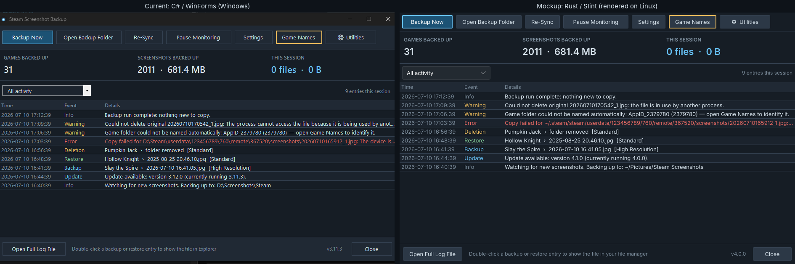
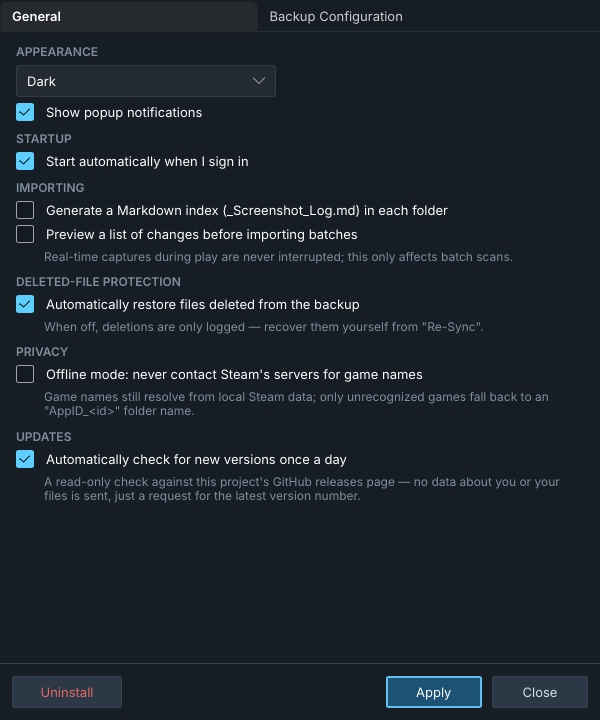
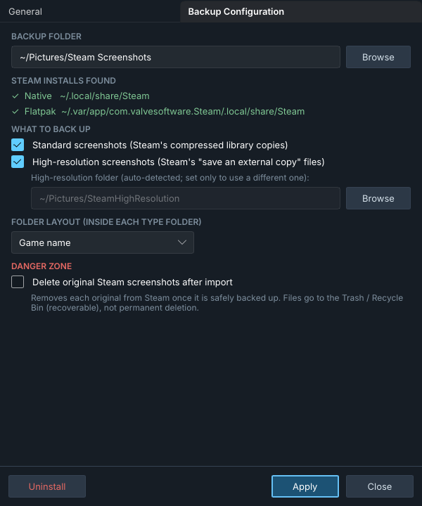
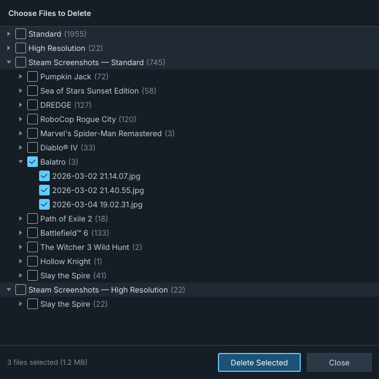
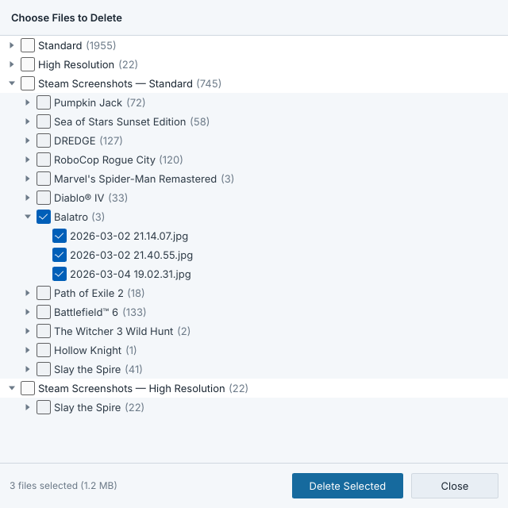
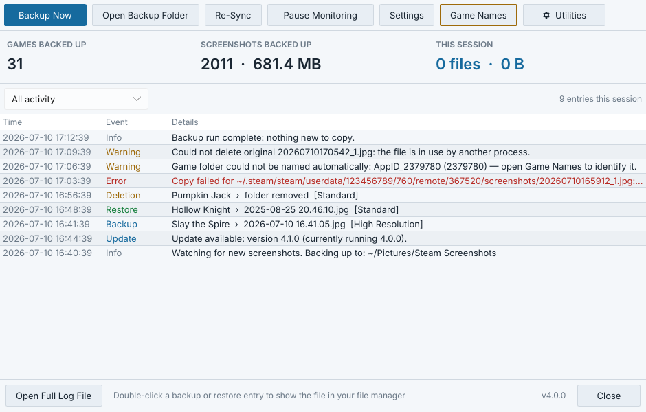

# Rust / Slint GUI mockup

A **non-functional** preview of what a cross-platform Rust rewrite of Steam
Screenshot Backup could look like, built with [Slint](https://slint.dev).
Every button is inert and all data is hard-coded; there is no backup engine,
tray icon, or file watching here. It exists only to judge the look and feel
before committing to a rewrite.

The colors are copied from `app/Theme.cs`, and the checkboxes, combo boxes,
tabs and text fields are Slint's stock `fluent` widgets, which switch between
light and dark along with the custom colors.

## Screenshots

These were rendered by the actual binary on Linux (Xvfb, Slint's software
renderer, Inter font), so they show no window title bar. On Windows the same
code would draw a native title bar and use Segoe UI.



| | |
|---|---|
|  |  |
|  |  |



## Running it

```sh
cargo run --release -- main             # or: settings | settings-backup | delete
cargo run --release -- delete --light   # light theme
```

On Linux, building needs `libfontconfig-dev`, and running needs
`libxkbcommon-x11` (X11) or a Wayland session.

## Layout

| File | What it is |
|---|---|
| `ui/theme.slint` | Light/dark palette shared by every window |
| `ui/widgets.slint` | Flat `AppButton` and small text helpers |
| `ui/main-window.slint` | Toolbar, stats strip, filterable activity log |
| `ui/settings-window.slint` | Both Settings tabs |
| `ui/delete-window.slint` | Granular Deletion tree (Slint has no tree widget, so it is a flattened list with indents) |
| `src/main.rs` | Picks a window from the command line and shows it |
